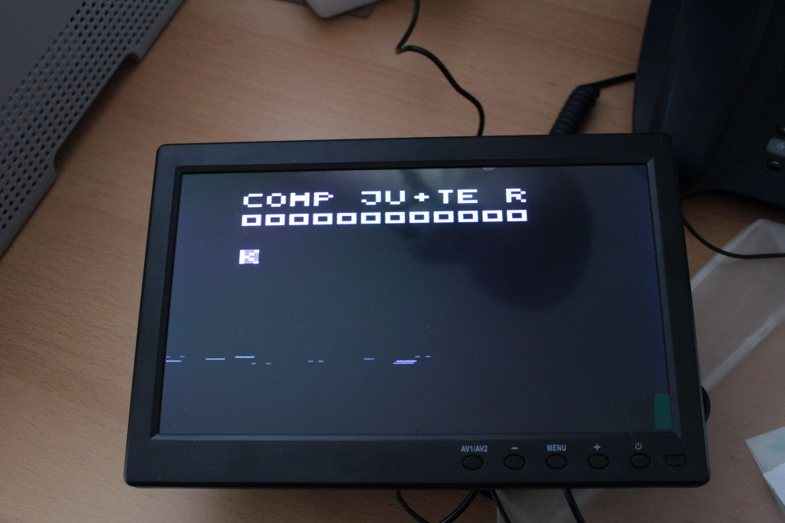
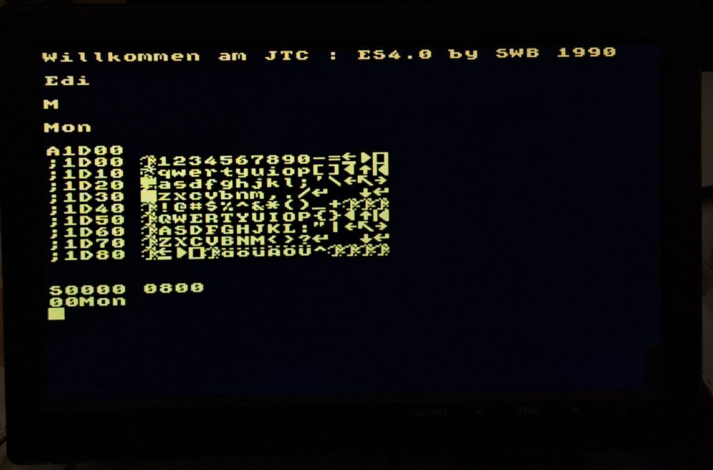
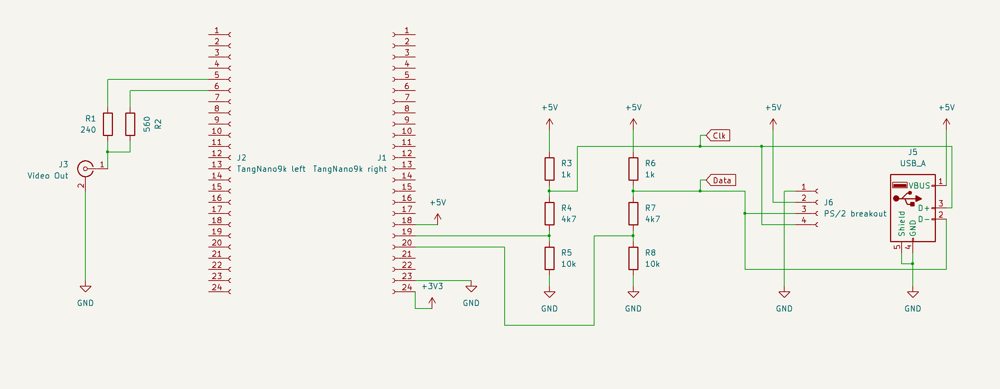

# Z8 Softcore

The project is about implementing a Zilog Z8 microcontroller in Verilog.

So far it can run the [Tiny computer](https://hc-ddr.hucki.net/wiki/doku.php/tiny) which generates the TV-video output using a timer interrupt:

and its 320x192 pixels extension (here only one 8kB video RAM for monochrome output) with separate video processor:

on a Tang Tano 9k:

## Notes for Gowin-IDE 1.9.11.03 Education
- in *Project | Configuration*, page *Synthesize* set *Verilog Language* to **System Verilog 2017**
- use right most toolbar buttons to *Synthesize*, *Run Place and Route*, or *Run All*
- Programmer:
  - in *Cable Setting* dialog change *Port* from *USB Debugger A/0/386/null* to **USB Debugger A/1/385/null**
  - *SRAM Program* -> temporary
  - *Embedded Flash Mode* -> permanently

## OSS CAD Suite on Windows

Extract the [Windows x64 OSS CAD Suite](https://github.com/YosysHQ/oss-cad-suite-build/releases/latest)
to `C:\oss-cad-suite`, then run `build_es40.cmd` from a Command Prompt. If installed
elsewhere, adjust the environment path near the top of the script.

The script builds the source set from `jtc_es40.gprj` for the Tang Nano 9K using
Yosys, nextpnr-himbaechel, and Apicula. The existing rPLL wrapper and inferred
RAM/ROM are supported. The shared output is `build\project.fs`, with build logs
alongside it. Before synthesis, the script clears the previous bitstream; if a
build stage fails, it removes any partial output.

For `jtc_es40_hdmi.gprj`, run `build_es40_hdmi.cmd` instead. It uses the HDMI pin
constraints and `src/constraints_es40_hdmi.py` for the 4 MHz SoC, 25.2 MHz pixel, and
126 MHz serializer clocks. Update those timing constraints if you change the
HDMI PLL settings. It also produces `build\project.fs` for the programming scripts.
The build generates `build\jtc_es40_hdmi.cst` with explicit negative HDMI pin
locations required by nextpnr, based on the project's Gowin constraints.

After building, use either programming script from a Command Prompt:

| Script | openFPGALoader option | Target |
| --- | --- | --- |
| `flash_sram.cmd` | `-m` | SRAM: runs immediately until power-off; preserves embedded flash. |
| `flash_embedded_flash.cmd` | `-f` | Embedded configuration flash: retained and loaded at power-on. |

Both scripts use `build\project.fs` and initialize the OSS CAD Suite environment.
They resolve the bitstream relative to the script location, so they can be run
from any current directory. Adjust their environment paths too if needed.
The filename is independent of the built project; the target board is Tang Nano 9K.
See the [openFPGALoader programming guide](https://trabucayre.github.io/openFPGALoader/guide/first-steps.html)
and [Gowin driver](https://github.com/trabucayre/openFPGALoader/blob/master/src/gowin.cpp)
for SRAM and embedded flash selection.

## State of the Z8 Softcore

- [x] implement all operations
  - [x] `nop`
  - [x] carry-flag manipulation operations
  - [x] `srp #IM`
  - [x] single-register ALU operations
    - [x] `xxx R`
    - [x] `xxx IR`
    - [x] `inc r`
  - [x] dual-register ALU operations
    - [x] `xxx r, r`
    - [x] `xxx r, Ir`
    - [x] `xxx R, R`
    - [x] `xxx R, IR`
    - [x] `xxx R, #IM`
    - [x] `xxx IR, #IM`
  - [x] load operations
    - [x] `ld r, #IM`
    - [x] `ld r, R`
    - [x] `ld R, r`
    - [x] `ld r, Ir`
    - [x] `ld Ir, r`
    - [x] `ld R, R`
    - [x] `ld R, IR`
    - [x] `ld IR, R`
    - [x] `ld R, #IM`
    - [x] `ld IR, #IM`
    - [x] `ld r, r(x)`
    - [x] `ld r(x), r`
  - [x] control flow operations
    - [x] `djnz r, RA`
    - [x] `jr cc, RA`
    - [x] `jp cc, DA`
    - [x] `jp IRR`
  - [x] `di`, `ei` (disable/enable interrupt)
  - [x] memory operations
    - [x] `ldc r, Irr`
    - [x] `ldc Irr, r`
    - [x] `ldci Ir, Irr`
    - [x] `ldci Irr, Ir`
    - [x] let `lde`/`ldei` work the same as `ldc`/`ldci`
  - [x] stack operations
    - [x] internal stack
      - [x] `pop R`
      - [x] `pop IR`
      - [x] `push R`
      - [x] `push IR`
      - [x] `call IRR`
      - [x] `call DA`
      - [x] `ret`
      - [x] `iret`
    - [x] external stack
  - [x] illegal instruction handling (stop at that address)
- [ ] port 2
  - [ ] input
  - [x] output
- [ ] port 3
  - [ ] P30-P33 generic input
  - [x] P34-P37 generic output
  - [ ] special counter/serial input/output
- [ ] Timers/Counters
  - [x] basics
  - [ ] special external modes
  - [ ] UART
    - [x] basics
    - [ ] parity handling
- [ ] interrupt handling
  - [x] basics (launching the right interrupt)
  - [ ] handle priorities
